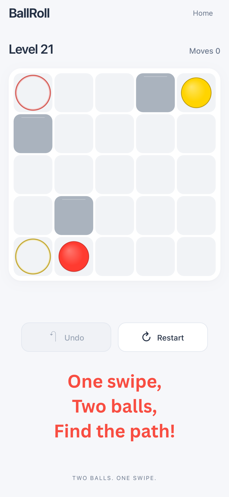
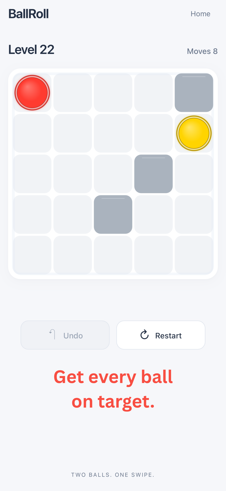
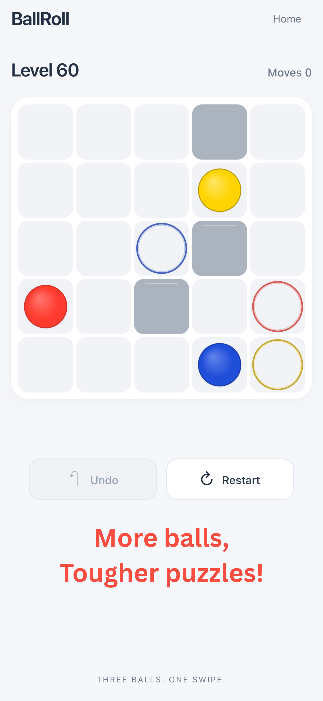

# BallRoll

**Mobile puzzle game with 100 handcrafted levels**

BallRoll is a level-based mobile puzzle game designed around progressive challenge, player learning, and short repeatable sessions. The project was taken from gameplay structure and level progression through release hardening, native iOS packaging, App Store review, and public release.

**[View BallRoll on the App Store](https://apps.apple.com/tr/app/ballroll-logic-puzzle/id6817675040?l=tr)**

## Showcase

  
  
  

The screenshots show the product progression from the core two-ball mechanic, through a completed puzzle state, to later levels with more balls and higher puzzle complexity.

## Product Focus

The core product challenge was not only creating individual puzzles, but structuring a 100-level experience that could teach the player, increase complexity gradually, preserve progress reliably, and remain stable across mobile sessions.

## Product Ownership & Level Design

- Structured a 100-level progression system with increasing challenge
- Iterated on difficulty pacing and the player learning curve across the level set
- Designed progression, retry, completion, and persistence flows
- Used repeated playtesting to identify unclear, frustrating, or inconsistent gameplay states
- Balanced challenge with accessibility so early levels teach the interaction before later levels increase complexity
- Treated level order and difficulty as product decisions rather than isolated content creation
- Took the game from web prototype through physical-device validation, App Store review, and public iOS release

## Product Decisions

**Progression**  
The level sequence was structured to introduce the game's logic progressively instead of exposing full difficulty immediately. The goal was to create a learning curve in which earlier levels build familiarity and later levels demand stronger execution.

**Difficulty pacing**  
Difficulty was tuned across the full level set rather than level-by-level in isolation, with attention to sudden spikes that could create unnecessary player frustration or abandonment.

**Player continuity**  
Persistent progress and conservative storage recovery were treated as part of the player experience so returning users could reliably continue from their previous state.

**Mobile reliability**  
Input guards, focus handling, background/foreground lifecycle behavior, and safe-area readiness were hardened because interruptions and device-state changes are part of the real mobile user journey.

## Metrics & Experimentation Framework

The release was built and validated primarily through structured playtesting, solver-backed tooling, automated testing, and QA rather than large-scale live player data.

With the game now publicly distributed, the next product validation layer can focus on metrics such as:

- level completion rate
- attempts per level
- time to complete each level
- retry rate after failure
- progression drop-off by level
- difficulty spikes across the level sequence

These signals can provide a basis for level reordering, difficulty tuning, and controlled gameplay experiments. No production A/B-test results are claimed for the current version.

## Quality & Release

- Exactly 100 production levels
- 180 automated tests in the release-hardened web build
- Conservative local-storage recovery
- Input and focus guards
- Background / foreground lifecycle handling
- Safe-area-ready mobile layout
- Relative asset-path hardening for native packaging
- Zero runtime dependencies in the hardened web build
- Native iOS packaging with Capacitor
- Physical-device validation
- Public App Store release

## Tech Stack

`JavaScript` · `Vite` · `Capacitor` · `iOS`

## Current Status

**Live on the App Store**

[Download BallRoll on the App Store](https://apps.apple.com/tr/app/ballroll-logic-puzzle/id6817675040?l=tr)

## Developer Website

[ozankazbas.github.io](https://ozankazbas.github.io)

## Support

Public support and privacy information is maintained separately in the [ballroll-support](https://github.com/ozankazbas/ballroll-support) repository.

---

This repository is a public product showcase. The production game source code is kept private.
